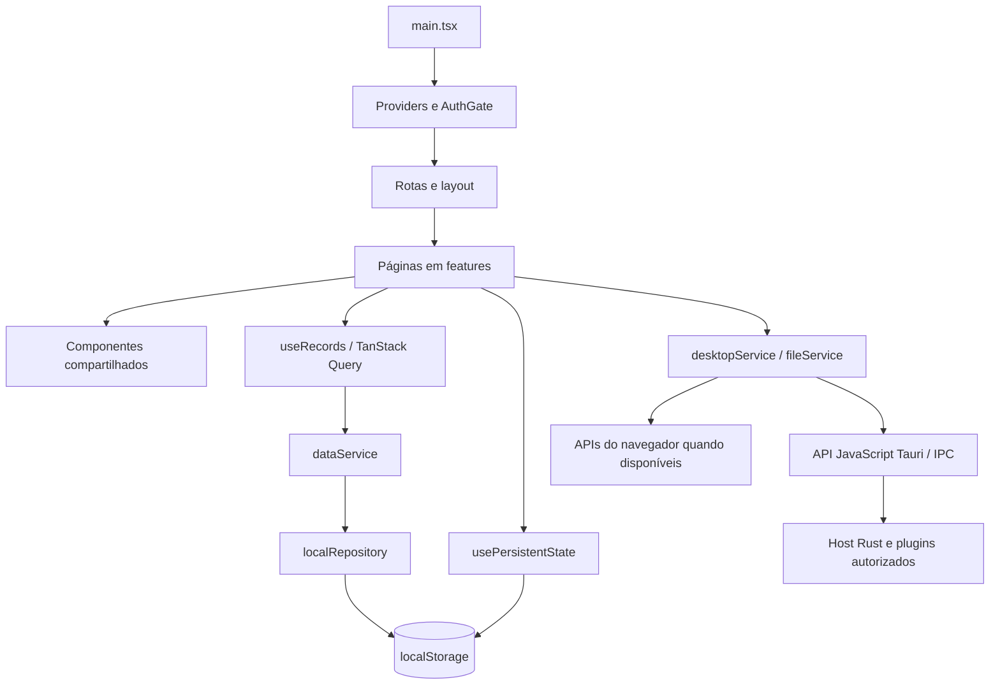

# Stack técnica e arquitetura

O **Desktop UI Showcase** é uma aplicação desktop de demonstração construída com Tauri 2, React e TypeScript. Reúne dashboards, cadastros, formulários, relatórios e exemplos de integração com o sistema operacional. Também pode ser executada no navegador, com adaptações para as operações nativas.

Este documento descreve a implementação existente. As tecnologias principais atendem ao [prompt do projeto](prompt-tauri-sample.md); as decisões abaixo registram a organização adotada, sua justificativa técnica e suas consequências. Para instalação, execução e geração do aplicativo, consulte o [README](README.md).

## 1. Stack principal

As versões JavaScript abaixo são as **faixas declaradas** no [package.json](package.json), não uma lista de versões instaladas. As resoluções das dependências ficam em [pnpm-lock.yaml](pnpm-lock.yaml) e [Cargo.lock](src-tauri/Cargo.lock).

| Tecnologia        | Versão declarada                          | Papel no projeto                                                                                      |
| ----------------- | ----------------------------------------- | ----------------------------------------------------------------------------------------------------- |
| Tauri             | Rust `2`; API JS `^2.11.1`; CLI `^2.11.4` | Janela desktop, comunicação com APIs nativas e empacotamento.                                         |
| Rust              | Edição `2021`                             | Inicialização do aplicativo e registro dos plugins Tauri. A edição não fixa uma versão do compilador. |
| React / React DOM | `^19.3.0`                                 | Componentes, composição das telas, hooks e renderização na WebView.                                   |
| TypeScript        | `^5.9.3`                                  | Tipagem das entidades, propriedades, serviços e formulários, com modo estrito.                        |
| Vite              | `^8.3.0`                                  | Servidor de desenvolvimento e geração dos arquivos estáticos de produção.                             |
| Tailwind CSS      | `^4.3.3`                                  | Estilização utilitária, layout responsivo e integração com tokens de tema.                            |
| React Router DOM  | `^7.18.3`                                 | Navegação por `HashRouter` e definição das rotas das funcionalidades.                                 |
| pnpm              | `11.19.0`                                 | Gerenciamento de dependências e execução dos scripts do projeto.                                      |

No aplicativo instalado, o frontend roda na WebView do sistema operacional. O executável Rust hospeda essa interface e disponibiliza os plugins autorizados. Não há servidor Node.js em execução no aplicativo empacotado; Vite e Node.js participam do desenvolvimento e do build.

## 2. Bibliotecas utilizadas

### Interface e design system

| Biblioteca / recurso       | Versão declarada              | Como é utilizado                                                                                                                         |
| -------------------------- | ----------------------------- | ---------------------------------------------------------------------------------------------------------------------------------------- |
| shadcn/ui                  | Código incorporado ao projeto | Componentes editáveis em `src/components/ui`, configurados pelo `components.json`. Não é uma dependência de runtime chamada `shadcn/ui`. |
| `radix-ui`                 | `^1.6.7`                      | Primitivas de interação para diálogos, menus, popovers, selects, tabs e outros controles.                                                |
| `class-variance-authority` | `^0.7.1`                      | Variantes visuais tipadas, como tamanhos e estilos de botões.                                                                            |
| `clsx`                     | `^2.1.1`                      | Composição condicional de classes CSS.                                                                                                   |
| `tailwind-merge`           | `^3.7.0`                      | Resolução de conflitos entre classes Tailwind na função compartilhada `cn`.                                                              |
| `lucide-react`             | `^1.45.0`                     | Ícones usados na navegação, ações e indicadores.                                                                                         |
| `sonner`                   | `^2.0.8`                      | Toasts de sucesso, erro e feedback das operações.                                                                                        |
| `recharts`                 | `^3.10.1`                     | Gráficos reutilizados no dashboard e nos relatórios.                                                                                     |

Os tokens de cor, temas, animações e regras de impressão estão em [globals.css](src/styles/globals.css). O [ThemeProvider](src/app/providers/theme-provider.tsx) gerencia os modos claro, escuro e sistema. A configuração shadcn/ui usa o estilo `new-york`, base neutra e variáveis CSS.

### Dados, tabelas e formulários

| Biblioteca              | Versão declarada | Como é utilizada                                                                                  |
| ----------------------- | ---------------- | ------------------------------------------------------------------------------------------------- |
| `@tanstack/react-query` | `^5.102.8`       | Consultas, cache, estados de carregamento/erro e mutações dos cadastros.                          |
| `@tanstack/react-table` | `^8.21.3`        | Modelo de tabela com ordenação, filtros, paginação, seleção e configuração de colunas no cliente. |
| `react-hook-form`       | `^7.88.0`        | Estado, submissão e integração dos principais formulários com validação.                          |
| `zod`                   | `^4.6.4`         | Schemas de validação e inferência de tipos para dados dos formulários.                            |
| `@hookform/resolvers`   | `^5.9.1`         | Integração dos schemas Zod com React Hook Form.                                                   |

### Exportação de relatórios

| Biblioteca      | Versão declarada | Como é utilizada                                                                 |
| --------------- | ---------------- | -------------------------------------------------------------------------------- |
| `html-to-image` | `^1.11.13`       | Captura de elementos visuais para PNG e imagens dos gráficos.                    |
| `jspdf`         | `^4.2.1`         | Criação de PDF com indicadores, tabela paginada, cabeçalhos, rodapés e gráficos. |

A geração do conteúdo fica em [export-report.ts](src/features/reports/export-report.ts). O [file-service.ts](src/services/file-service.ts) decide entre salvar pelo diálogo nativo do Tauri e iniciar um download no navegador. A impressão utiliza `window.print()` e estilos específicos de impressão.

### Plugins nativos

Cada plugin possui um pacote JavaScript consumido pelo frontend e uma dependência Rust registrada em [lib.rs](src-tauri/src/lib.rs). Todos os plugins Rust estão declarados na versão principal `2` em [Cargo.toml](src-tauri/Cargo.toml).

| Pacote JavaScript                      | Versão declarada | Dependência Rust                 | Recurso                                              |
| -------------------------------------- | ---------------- | -------------------------------- | ---------------------------------------------------- |
| `@tauri-apps/plugin-dialog`            | `^2.7.3`         | `tauri-plugin-dialog`            | Seleção de arquivos/pastas e diálogo de salvamento.  |
| `@tauri-apps/plugin-fs`                | `^2.5.2`         | `tauri-plugin-fs`                | Leitura e escrita dos arquivos autorizados.          |
| `@tauri-apps/plugin-clipboard-manager` | `^2.3.3`         | `tauri-plugin-clipboard-manager` | Leitura e escrita de texto na área de transferência. |
| `@tauri-apps/plugin-notification`      | `^2.4.0`         | `tauri-plugin-notification`      | Permissão e envio de notificações nativas.           |
| `@tauri-apps/plugin-opener`            | `^2.5.5`         | `tauri-plugin-opener`            | Abertura do endereço externo permitido.              |
| `@tauri-apps/plugin-os`                | `^2.3.2`         | `tauri-plugin-os`                | Informações sobre o sistema operacional.             |

Os controles da janela usam a API principal do Tauri. O projeto não possui comandos Rust próprios para regras de negócio, banco de dados nativo ou integração de atualização automática configurada.

### Desenvolvimento e qualidade

| Ferramenta                    | Versão declarada | Finalidade                                                             |
| ----------------------------- | ---------------- | ---------------------------------------------------------------------- |
| `@vitejs/plugin-react`        | `^6.1.1`         | Integração React com Vite.                                             |
| `@tailwindcss/vite`           | `^4.3.3`         | Integração Tailwind com o build Vite.                                  |
| ESLint / `@eslint/js`         | `^9.39.5`        | Análise estática do código.                                            |
| `typescript-eslint`           | `^8.70.0`        | Regras e análise de TypeScript no ESLint.                              |
| `eslint-plugin-react-hooks`   | `^7.1.1`         | Verificação das regras de hooks.                                       |
| `eslint-plugin-react-refresh` | `^0.5.6`         | Verificação de exports compatíveis com atualização dos componentes.    |
| Prettier                      | `^3.9.6`         | Formatação do código e da documentação.                                |
| Vitest                        | `^5.0.0`         | Testes unitários de domínio, schemas e operações de dados.             |
| `@playwright/test`            | `^1.63.0`        | Testes de interface no navegador Google Chrome.                        |
| `@axe-core/playwright`        | `^4.13.0`        | Verificações automatizadas de acessibilidade integradas ao Playwright. |

As dependências de suporte incluem `@types/node`, `@types/react`, `@types/react-dom` e `globals`. No Rust, `tauri-build` integra a configuração do aplicativo ao processo de compilação.

## 3. Organização das pastas

```text
TauriSample/
├── src/
│   ├── main.tsx                 # Entrada React, providers e estilos
│   ├── app/
│   │   ├── config/              # Configuração central da navegação
│   │   ├── layouts/             # Estrutura principal: sidebar, header e conteúdo
│   │   ├── providers/           # Query, tema, autenticação e loading global
│   │   └── routes/              # Rotas e carregamento das páginas
│   ├── components/
│   │   ├── ui/                  # Primitivas shadcn/ui, incluindo wrappers Radix
│   │   ├── atoms/               # Reexports das primitivas e identidade visual
│   │   ├── molecules/           # Campos, cards, status, filtros e confirmações
│   │   ├── organisms/           # DataTable, ResourcePage, header e sidebar
│   │   └── templates/           # Page e Panel para composição das páginas
│   ├── features/               # Módulos funcionais e componentes específicos
│   ├── hooks/                  # useRecords e usePersistentState
│   ├── services/
│   │   ├── repositories/       # Repositório local e dados iniciais
│   │   ├── auth-service.ts      # Login de demonstração
│   │   ├── data-service.ts      # Operações assíncronas dos cadastros
│   │   ├── desktop-service.ts   # Adaptação das APIs desktop/navegador
│   │   └── file-service.ts      # Salvamento de arquivos
│   ├── stores/                 # Contextos e contratos de autenticação/loading
│   ├── types/                  # Entidades e tipos compartilhados
│   ├── schemas/                # Validação Zod de autenticação e cadastros
│   ├── constants/              # Gradientes da splash e do login
│   ├── utils/                  # Formatação e composição de classes
│   ├── assets/                 # Logotipo SVG
│   └── styles/                 # CSS global, tokens, temas e impressão
├── src-tauri/
│   ├── src/main.rs             # Entrada do executável
│   ├── src/lib.rs              # Inicialização do Tauri e registro dos plugins
│   ├── capabilities/           # Permissões da janela principal
│   ├── icons/                  # Ícones para empacotamento
│   ├── build.rs                # Integração com tauri-build
│   ├── Cargo.toml              # Manifesto Rust
│   ├── Cargo.lock              # Resolução das dependências Rust
│   └── tauri.conf.json         # Janela, build, CSP e bundles
├── tests/
│   ├── unit/domain.test.ts     # Testes de domínio e persistência
│   └── e2e/showcase.spec.ts     # Fluxos de interface e acessibilidade
├── docs/                       # Capturas e arquivos de exemplo
├── components.json             # Configuração do shadcn/ui
├── package.json                # Dependências e scripts JavaScript
├── pnpm-lock.yaml              # Resolução das dependências JavaScript
├── pnpm-workspace.yaml         # Configuração do pnpm
├── vite.config.ts              # Plugins, alias e servidor de desenvolvimento
├── tsconfig.json               # Compilação e checagem TypeScript
├── eslint.config.js            # Regras de análise estática
├── vitest.config.ts            # Configuração dos testes unitários
├── playwright.config.ts        # Configuração dos testes de interface
├── index.html                  # Documento de entrada do frontend
├── prompt-tauri-sample.md       # Requisitos originais
├── README.md                   # Apresentação e operação do projeto
└── Stack.md                    # Stack e decisões de arquitetura
```

### Módulos em `features/`

| Pastas                            | Responsabilidade                                                |
| --------------------------------- | --------------------------------------------------------------- |
| `authentication`                  | Splash, login e controle de acesso à interface de demonstração. |
| `dashboard`                       | Indicadores, cálculos de métricas e gráficos compartilhados.    |
| `customers`, `products`, `orders` | Cadastros, editores, detalhes e ações sobre registros.          |
| `tables`                          | Demonstração das funções da tabela reutilizável.                |
| `reports`                         | Visualização, exportação e histórico local dos relatórios.      |
| `forms`, `wizard`                 | Exemplos de formulários e preenchimento em etapas.              |
| `notifications`, `feedback`       | Central de notificações, toasts, loading e modais.              |
| `kanban`, `calendar`, `timeline`  | Organização de tarefas e visualizações temporais.               |
| `upload`                          | Seleção de arquivos, previews e progresso simulado.             |
| `commands`                        | Central de comandos e atalhos.                                  |
| `desktop`                         | Demonstração das integrações nativas.                           |
| `settings`                        | Preferências e perfil.                                          |
| `design-system`                   | Catálogo dos componentes e padrões visuais.                     |

Arquivos gerados, como `dist/`, `node_modules/`, `src-tauri/target/` e relatórios de testes, não fazem parte da organização do código-fonte.

## 4. Fluxo da aplicação



O [AppProviders](src/app/providers/app-providers.tsx) organiza o contexto na sequência: Query → tema → HashRouter → tooltips → autenticação → loading → AuthGate. O `AuthGate` apresenta a splash e, conforme a sessão, o login ou as páginas. O `Toaster` disponibiliza feedback global.

Nos cadastros de clientes, produtos e pedidos, `useRecords` consulta o serviço e executa mutações. Após uma alteração, invalida as consultas da coleção para atualizar a interface. O serviço simula latência e situações de sucesso, erro ou lista vazia, enquanto o repositório lê e grava JSON no armazenamento local.

Kanban, calendário, notificações e outros exemplos simples utilizam `usePersistentState` diretamente. Portanto, a camada de serviços/repositório dos cadastros não é uma exigência aplicada a todos os módulos existentes.

## 5. Decisões de arquitetura

### D01 — Tauri como host nativo e React como interface

**Decisão:** manter a composição visual e as regras dos exemplos em TypeScript; usar Rust para inicializar o host e registrar plugins. O código nativo atual é pequeno e não implementa serviços de negócio próprios.

**Justificativa e consequência:** essa divisão atende ao showcase desktop com uma interface reaproveitável no navegador. A renderização depende da WebView de cada plataforma, e os recursos nativos precisam de validação específica no sistema operacional de destino.

Referências: [entrada React](src/main.tsx), [entrada Rust](src-tauri/src/main.rs) e [registro dos plugins](src-tauri/src/lib.rs).

### D02 — Módulos por funcionalidade e componentes por composição

**Decisão:** organizar páginas e detalhes de negócio em `features/`, mantendo componentes compartilhados em níveis de composição: `ui`, `atoms`, `molecules`, `organisms` e `templates`.

**Justificativa e consequência:** mudanças de uma funcionalidade ficam próximas umas das outras, enquanto padrões visuais podem ser reutilizados. `ui/` contém código incorporado ao repositório e mantido pelo projeto; `atoms/` também reexporta essas primitivas. As páginas completas ficam nas funcionalidades, sem uma pasta global `pages/`.

O alias `@/` aponta para `src/`, configurado no TypeScript e no Vite. Componentes específicos de um cadastro permanecem na respectiva funcionalidade até existir uma necessidade concreta de compartilhamento.

### D03 — Navegação por hash e carregamento sob demanda

**Decisão:** usar `HashRouter`, com URLs como `#/customers`, e carregar as páginas por `React.lazy` e `Suspense`.

**Justificativa e consequência:** o hash permite navegação sem depender de regras de reescrita de URLs no servidor que entrega os arquivos locais. O carregamento sob demanda divide o código das páginas; durante a primeira abertura de uma rota, a interface precisa apresentar o fallback de carregamento.

A [configuração da navegação](src/app/config/navigation.ts) fornece os itens da sidebar e os destinos usados na central de comandos. As rotas ficam em [app-routes.tsx](src/app/routes/app-routes.tsx).

### D04 — Estado dividido conforme a responsabilidade

**Decisão:** usar estado local React para interações temporárias; Context para autenticação, tema e loading; TanStack Query para dados consultados assincronamente; e `usePersistentState` para preferências e exemplos persistidos diretamente.

**Justificativa e consequência:** cada mecanismo atende a um ciclo de vida distinto, sem uma store global de Redux ou Zustand. O QueryClient considera dados recentes por 30 segundos e permite uma repetição em caso de falha. As chaves dos cadastros incluem coleção e modo de simulação.

O [hook de persistência](src/hooks/use-persistent-state.ts) usa `useSyncExternalStore`, eventos locais e o evento `storage` para atualizar consumidores da mesma chave. Essa sincronização não equivale à invalidação automática do cache TanStack Query entre abas para os cadastros.

### D05 — Dados locais e serviços assíncronos simulados

**Decisão:** armazenar os cadastros em `localStorage`, sob chaves `showcase.data.<coleção>`, e inicializá-los com dados fictícios quando não houver JSON válido armazenado. Não existe API remota, banco SQL ou ORM.

**Justificativa e consequência:** a demonstração funciona sem infraestrutura externa, com cenários reproduzíveis de carregamento e erro. A persistência pertence à origem da aplicação; navegador, ambiente de desenvolvimento e aplicativo instalado podem ter armazenamentos diferentes. Não há sincronização multiusuário nem migrações versionadas de dados.

O [dataService](src/services/data-service.ts) concentra listagem, criação/atualização, remoção e mudança de status. Para integrar um backend, esse contrato é um ponto inicial de substituição; os módulos que persistem diretamente também precisariam ser adaptados. O [seed](src/services/repositories/seed.ts) fornece 100 clientes, 50 produtos e 150 pedidos.

### D06 — Autenticação de demonstração

**Decisão:** validar credenciais fixas no [auth-service.ts](src/services/auth-service.ts) e persistir o usuário em `localStorage` ou `sessionStorage`, conforme a opção de lembrar a sessão. A senha não é persistida.

**Justificativa e consequência:** o fluxo demonstra splash, login, sessão e saída sem exigir um provedor de identidade. O bloqueio das páginas é visual e local: não constitui autenticação de servidor nem autorização para dados protegidos. Uma aplicação real precisaria substituir esse mecanismo e validar permissões no backend.

### D07 — Design system em código e validação por schemas

**Decisão:** manter os componentes shadcn/ui no repositório, combinar Radix com Tailwind e centralizar tokens no CSS. Nos principais formulários, usar React Hook Form com Zod e resolvers.

**Justificativa e consequência:** o projeto controla aparência e composição, com primitivas de interação reaproveitáveis. Atualizações dos componentes incorporados exigem revisão do código local. Radix auxilia foco e teclado, mas não garante sozinho a acessibilidade de todas as telas.

Os [schemas compartilhados](src/schemas) concentram validações de autenticação e cadastros. Há também validações locais, chamadas diretas a `safeParse` e validação HTML em exemplos mais simples. A validação demonstrativa de CPF/CNPJ verifica comprimento, sem implementar o cálculo de dígitos verificadores.

### D08 — Tabelas e CRUD reutilizáveis no cliente

**Decisão:** encapsular TanStack Table em [DataTable](src/components/organisms/data-table.tsx) e compartilhar a composição dos cadastros por [ResourcePage](src/components/organisms/resource-page.tsx), recebendo colunas, editores e ações específicos.

**Justificativa e consequência:** filtros, seleção, ordenação, paginação e operações de cadastro mantêm comportamento consistente. Todo o conjunto de dados é processado no cliente, adequado aos volumes de demonstração. Grandes volumes exigiriam paginação, filtros e ordenação no serviço remoto.

### D09 — APIs nativas atrás de adaptadores e permissões explícitas

**Decisão:** concentrar diferenças de ambiente em `desktop-service.ts` e `file-service.ts`, detectar o runtime Tauri e importar plugins quando necessário. No navegador, usar alternativas disponíveis, como clipboard e download por Blob.

**Justificativa e consequência:** as telas compartilham a maior parte do código entre navegador e desktop. Operações exclusivas do host, como controlar a janela nativa, continuam dependendo do Tauri.

As [capabilities](src-tauri/capabilities/default.json) autorizam operações específicas para a janela principal. Os diálogos de arquivo delimitam os caminhos selecionados; não há um escopo global de diretórios configurado. O opener está restrito ao endereço `https://v2.tauri.app`. A [configuração Tauri](src-tauri/tauri.conf.json) define a política de segurança de conteúdo (CSP). Adicionar uma integração pode exigir tanto código quanto novas permissões.

### D10 — Exportação local e exemplos com APIs da plataforma

**Decisão:** gerar PNG e PDF no frontend e delegar somente o salvamento ao adaptador de arquivos. O histórico mantém metadados das exportações. Usar drag and drop HTML no Kanban, `Date` no calendário e File/Object URLs no upload, sem bibliotecas dedicadas para esses três exemplos.

**Justificativa e consequência:** os exemplos permanecem autocontidos e não dependem de serviços de conversão ou upload. O upload demonstra seleção, preview e progresso simulado; não transmite arquivos a um servidor. A janela Tauri desativa sua captura nativa de drag and drop para permitir o comportamento HTML.

### D11 — Verificação de domínio e interface em camadas

**Decisão:** separar testes unitários Vitest de testes de interface Playwright, complementados por TypeScript, ESLint e verificações axe.

**Justificativa e consequência:** cálculos, validações e persistência podem ser testados sem abrir a interface; os fluxos de usuário são exercitados no navegador. A suíte existente contém sete testes unitários e oito testes de interface, cobrindo, entre outros pontos, cadastros, tabelas, temas, Kanban, relatórios e responsividade. Os indicadores usam dados fictícios e uma referência de data definida no código para manter o cenário demonstrativo previsível.

O Playwright está configurado para Google Chrome. Sua cobertura não substitui a validação dos diálogos, notificações, permissões e WebViews do aplicativo nativo em cada plataforma. As verificações axe automatizadas também não representam uma auditoria completa de acessibilidade.

## 6. Build, execução e manutenção

O Vite atende o desenvolvimento na porta fixa `1420`, com `strictPort` habilitado. O Tauri executa `pnpm dev` antes de abrir o aplicativo e `pnpm build` antes de empacotar. O build do frontend executa a checagem TypeScript e gera `dist/`, diretório consumido pelo host nativo.

| Comando            | Finalidade                                       |
| ------------------ | ------------------------------------------------ |
| `pnpm dev`         | Executar a interface no navegador.               |
| `pnpm tauri dev`   | Executar a aplicação desktop em desenvolvimento. |
| `pnpm build`       | Verificar tipos e gerar o frontend de produção.  |
| `pnpm tauri build` | Compilar e empacotar o aplicativo desktop.       |
| `pnpm typecheck`   | Verificar tipos sem emitir arquivos.             |
| `pnpm lint`        | Executar análise estática.                       |
| `pnpm test`        | Executar os testes unitários.                    |
| `pnpm test:e2e`    | Executar os testes de interface.                 |

Sem pnpm global, substitua `pnpm` por `npx --yes pnpm@11.19.0`, por exemplo: `npx --yes pnpm@11.19.0 tauri dev`.

Ao adicionar uma funcionalidade, crie seu módulo em `features/`, registre rota e navegação, reutilize os componentes compartilhados e escolha o mecanismo de estado conforme sua responsabilidade. Para novos cadastros, estenda os tipos, schemas e contratos de dados; para novos recursos nativos, revise também o registro dos plugins e as capabilities. Atualize este documento quando essas fronteiras ou dependências mudarem.
